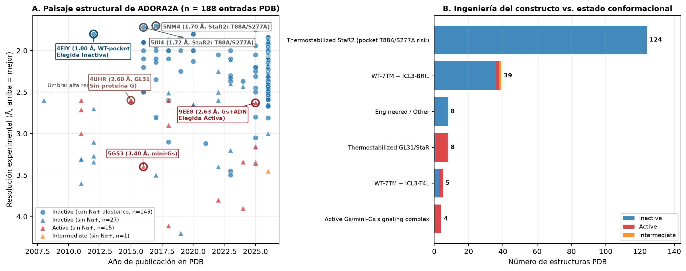
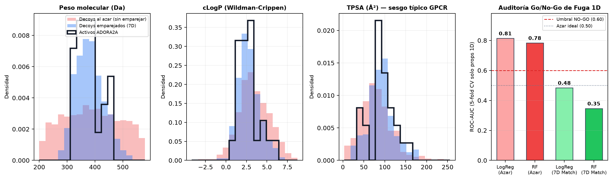
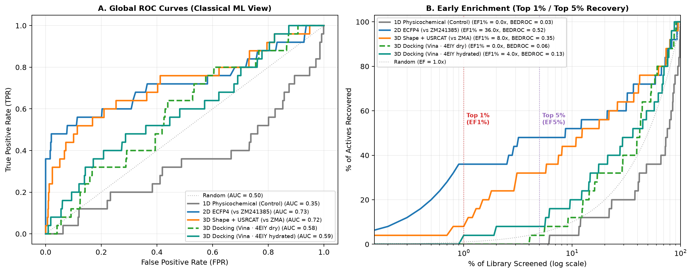
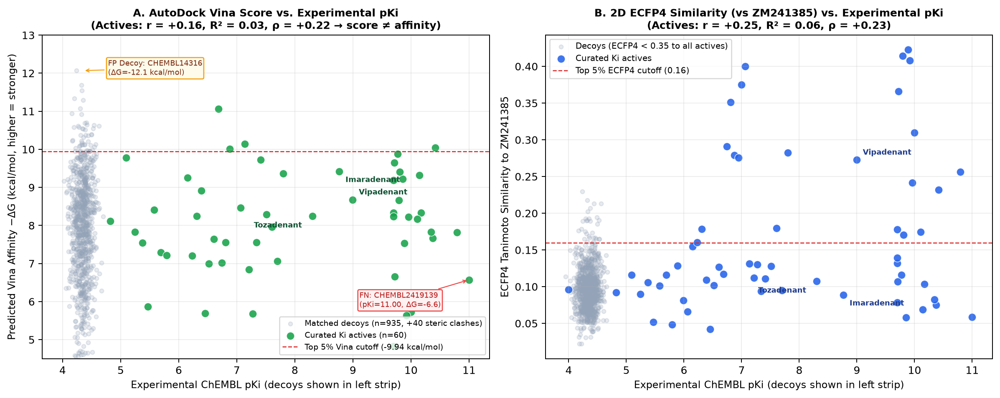

# ADORA2A Virtual Screening & Data Curation Audit

A reproducible case study on the human **Adenosine $A_{2A}$ receptor** (`ADORA2A`, UniProt [`P29274`](https://www.uniprot.org/uniprotkb/P29274), ChEMBL [`CHEMBL251`](https://www.ebi.ac.uk/chembl/target_report_card/CHEMBL251/)).

This project walks through the key data and modeling decisions needed **before** running a virtual screening campaign or training an ML model for drug discovery: choosing the right 3D protein structure, cleaning bioactivity data properly, preventing benchmark bias, and evaluating 2D, 3D-shape, and docking (**AutoDock Vina v1.2.7**) methods honestly.

---

## Key Takeaways (TL;DR)

1. **Don't pick a 3D protein structure by resolution alone:** 66% of human $A_{2A}$ structures in the PDB—including the two highest-resolution entries—carry engineered mutations (`T88A`, `S277A`) inside the binding pocket. Auditing all 188 structures led to selecting wild-type **`4EIY` (1.80 Å)** for antagonist screening.
2. **Clean bioactivity data carefully and keep provenance:** Separating binding affinity ($K_i$) from cellular $IC_{50}$ and tracking assay IDs narrowed 12,105 raw ChEMBL records to 4,972 clean compounds. Blindly applying automated structural-alert filters (PAINS/Brenk) would have deleted three real clinical drug candidates (`Tozadenant`, `Vipadenant`, `Imaradenant`).
3. **Always test your benchmark for "shortcut" bias:** With random decoys, a simple model using only basic molecular properties (`MW`, `LogP`, `TPSA`, etc.) reaches `ROC-AUC = 0.81` without learning real chemistry. Matching decoy properties removes this shortcut (`ROC-AUC < 0.50`).
4. **Use early-enrichment metrics and inspect negative results:** With only 2.5% active compounds, predicting "all inactive" gives `97.5%` accuracy. Using early enrichment (`EF1%`, `BEDROC`) shows that 2D similarity outperforms rigid docking here. Keeping 10 crystal waters fixes redocking of the native ligand (`10/10` runs `< 2.0 Å`), but rigid waters sterically block other diverse binders—and docking scores do **not** correlate with experimental binding strength ($pK_i$).

---

## Why This Matters

Virtual screening pipelines often look great on paper but fail in practice because of four common mistakes:

1. **Picking the wrong receptor structure:** Sorting PDB entries by resolution can select a mutated binding pocket or the wrong protein state (active vs. inactive).
2. **Mixing incompatible lab data:** Combining different assay types ($K_i$ vs. $IC_{50}$), losing track of assay IDs, or blindly deleting molecules flagged by generic alert rules.
3. **Unfair benchmarks (decoy bias):** If inactive "decoy" molecules have different size or polarity from actives, models can cheat using simple 1D properties.
4. **Misleading metrics & over-trusting docking scores:** Relying on classification *accuracy* on imbalanced datasets, or assuming better docking scores mean stronger binding affinity ($pK_i$).

---

## Results

### 1. Auditing All 188 `ADORA2A` Protein Structures ([reports/structure_audit.md](reports/structure_audit.md))

- **Pocket mutations are the majority:** **66.0% (`124 / 188`)** of human $A_{2A}$ PDB structures use the engineered `StaR2` construct—including the two highest-resolution structures (`5NM4` at 1.70 Å and `5IU4` at 1.72 Å)—which mutate two residues inside the binding pocket (`T88A` and `S277A`).
- **Active vs. inactive state check:** **0 / 15 (`0%`)** active-state structures contain the stabilizing sodium ion ($\text{Na}^+$), compared with **84.3% (`145 / 172`)** of inactive structures (**100%** at resolution $\le 1.90\text{ Å}$).
- **Selected reference structures:**
  - **`4EIY` (1.80 Å)** — wild-type inactive pocket with bound antagonist `ZM241385` and $\text{Na}^+$, used for antagonist screening.
  - **`9EE8` (2.63 Å)** — active-state cryo-EM structure with adenosine, kept as the active reference.
- **Dry vs. hydrated receptor setup:** Because pocket waters can mediate ligand binding in $A_{2A}$, we tested two receptor versions in AutoDock Vina: **`4EIY_dry`** (no waters) and **`4EIY_hydrated`**, which keeps **10 well-ordered crystal waters** near `ZM241385` (within `4.5 Å`, low mobility $B < 30\text{ Å}^2$, full occupancy, and at least one hydrogen bond $\le 3.5\text{ Å}$). Full preparation details are documented in [reports/structure_audit.md](reports/structure_audit.md).



---

### 2. ChEMBL Data Curation & Decoy-Bias Check

- **Bioactivity cleaning (`CHEMBL251`):** Starting from **12,105** raw `Ki`/`IC50` records, filtering for high-confidence exact measurements (`confidence_score >= 8`, relation `'='`, nanomolar units, no validity warnings) and isolating equilibrium binding $K_i$ assays produced **`5,901` measurements $\rightarrow$ `4,972` unique compounds** (`InChIKey`). We flagged `44` compounds with $> 1$ log-unit disagreement across assays and excluded `546` agonists from the antagonist screen.
- **Structural alerts need context:** Running PAINS/Brenk filters blindly would discard three clinical-stage $A_{2A}$ antagonists (`Tozadenant`, `Vipadenant`, and `Imaradenant`), so alerts are logged as flags rather than automatic deletions.
- **Removing 1D decoy bias:** Against random ChEMBL decoys, a simple classifier using only 7 basic physicochemical properties (`MW`, `cLogP`, `TPSA`, `HBD`, `HBA`, `RotBonds`, `Charge`) gets **ROC-AUC = `0.81` (Logistic Regression) / `0.78` (Random Forest)**, mainly because $A_{2A}$ ligands have higher polarity (`TPSA`). After matching decoys on all 7 properties and filtering out close chemical analogues (`ECFP4 < 0.35`), 1D ROC-AUC drops to **`0.484` (LogReg)** and **`0.346` (RF)**—passing the `< 0.60` bias check.



---

### 3. Redocking Validation & 1,000-Compound Benchmark (2.5% Hit Rate)

#### 3.1 Cognate Redocking of `ZM241385` (10 Random Seeds)

To check whether AutoDock Vina can reproduce the known crystal pose of `ZM241385` (threshold: heavy-atom $\text{RMSD} < 2.0\text{ Å}$), we ran 10 independent random seeds on both receptor setups:

| Receptor Setup | Top Pose RMSD (Å) | Top Pose $< 2.0\text{ Å}$ | Best-of-9 RMSD (Å) | Any Pose $< 2.0\text{ Å}$ | Energy Gap $\Delta E$ (kcal/mol) |
| :--- | :---: | :---: | :---: | :---: | :---: |
| **`4EIY_dry`** | `9.68 ± 0.02` | `0 / 10` | `1.34 ± 0.49` | `9 / 10` | `+0.188 ± 0.084` *(inverted pose ranked 1st)* |
| **`4EIY_hydrated` (10 waters)** | **`1.05 ± 0.15`** | **`10 / 10`** | **`1.05 ± 0.15`** | **`10 / 10`** | **`-0.254 ± 0.044`** *(native pose ranked 1st)* |

Without waters (`4EIY_dry`), Vina finds the correct binding pose in 9/10 runs (`1.34 Å`), but scores a flipped pose slightly higher. Keeping the 10 ordered pocket waters fixes this ranking error in **10/10 runs (`1.05 ± 0.15 Å`)**.

#### 3.2 Virtual Screening Benchmark (`25` Actives + `975` Matched Decoys)

All methods were evaluated on the exact same 1,000-compound set using early-enrichment metrics (**EF1%**, **EF5%**, **BEDROC**), global ranking (**ROC-AUC**, **PR-AUC**), and **Accuracy @ Top 1%** (to illustrate why accuracy is misleading):

| Screening Method | EF1% (95% CI) | EF5% (95% CI) | BEDROC ($\alpha=20$) | ROC-AUC | PR-AUC | Accuracy @ Top 1% |
| :--- | :---: | :---: | :---: | :---: | :---: | :---: |
| **1. 1D Properties (Control)** | `0.0x` `(0.0–0.0)` | `0.0x` `(0.0–0.8)` | `0.026` | `0.346` | `0.019` | `96.5%` |
| **2. 2D Similarity (`ECFP4` vs. `ZM241385`)** | **`36.0x`** `(16.0–40.0)` | **`9.6x`** `(5.6–13.6)` | **`0.519`** | `0.725` | **`0.433`** | `98.3%` |
| **3. 3D Ligand Shape (`USRCAT` + `O3A`)** | `8.0x` `(0.0–20.0)` | `6.4x` `(3.2–10.4)` | `0.355` | `0.722` | `0.166` | `96.9%` |
| **4. 3D Docking (`Vina · 4EIY dry`)** | `0.0x` `(0.0–0.0)` | `0.8x` `(0.0–2.8)` | `0.063` | `0.584` | `0.033` | `96.5%` |
| **5. 3D Docking (`Vina · 4EIY hydrated`)** | `4.0x` `(0.0–12.0)` | `1.6x` `(0.0–4.0)` | `0.128` | `0.593` | `0.043` | `96.7%` |

- **Why early enrichment matters:** `2D Similarity` (`0.725`) and `3D Shape` (`0.722`) have almost identical global `ROC-AUC`, yet `2D Similarity` finds **4.5× more actives in the Top 1%** (`EF1% = 36.0x` vs. `8.0x`). Meanwhile, a trivial model predicting "all inactive" gets `97.5%` accuracy.
- **Why rigid pocket waters help redocking but still struggle in screening:** Keeping the 10 waters improves overall `EF1%` from `0.0x` to `4.0x` (`BEDROC` `0.063` $\rightarrow$ `0.128`) and blocks `298 / 975` decoys. However, because Vina treats those waters as fixed, rigid obstacles, they also clash with `23 / 60` diverse $A_{2A}$ antagonists (such as `Tozadenant` and `Imaradenant`) that normally push some waters out of the pocket when binding. On the 21 actives that are structurally distinct from `ZM241385` (`ECFP4 < 0.35`), `4EIY_hydrated` drops to `EF1% = 0.0x` (`ROC-AUC = 0.571` vs. `0.625` dry).




---

### 4. Do Screening Scores Predict Binding Strength ($pK_i$)?

Across **60 experimentally measured $K_i$ binders** ($pK_i$ from `4.0` to `11.0`), none of the screening scores showed a meaningful linear correlation with experimental binding affinity:
- **`4EIY_dry` Vina:** $r = 0.16$, $R^2 = 0.03$ ($p = 0.22$)
- **`4EIY_hydrated` Vina:** $r = 0.12$, $R^2 = 0.01$ ($p = 0.36$)
- **2D `ECFP4` similarity:** $r = 0.25$, $R^2 = 0.06$

This confirms a standard rule in virtual screening: **docking scores are meant for coarse ranking/filtering, not for predicting exact binding affinity.**



---

## Repository Structure

- [`src/adora2a_audit/`](src/adora2a_audit/) — core Python package:
  - [`structures.py`](src/adora2a_audit/structures.py) — GPCRdb + RCSB PDB audit, pocket mutation checks, and crystal water selection (`gemmi`).
  - [`curation.py`](src/adora2a_audit/curation.py) — ChEMBL data cleaning, RDKit standardization, deduplication, and PAINS/Brenk audit.
  - [`decoys.py`](src/adora2a_audit/decoys.py) — 7D property-matched decoy selection and 1D bias check.
  - [`metrics.py`](src/adora2a_audit/metrics.py) — `EF1%`, `EF5%`, `BEDROC`, `ROC-AUC`, `PR-AUC`, and bootstrap confidence intervals.
  - [`benchmark.py`](src/adora2a_audit/benchmark.py) — dry/hydrated receptor prep, 10-seed redocking, 2D/3D baselines, scaffold split check, and AutoDock Vina scoring.
- [`scripts/run_audit_pipeline.py`](scripts/run_audit_pipeline.py) — reproducible end-to-end CLI pipeline.
- [`notebooks/01_adora2a_retrospective_audit.ipynb`](notebooks/01_adora2a_retrospective_audit.ipynb) — executed walkthrough notebook.
- [`reports/structure_audit.md`](reports/structure_audit.md) — detailed audit of all 188 PDB structures and `4EIY` waters.
- [`reports/executive_summary.md`](reports/executive_summary.md) — full technical summary and pipeline recommendations.
- [`tests/`](tests/) — unit tests (`pytest`).

---

## How to Run

```bash
# 1. Install the package with dev dependencies
pip install -e ".[dev]"

# 2. Run the full audit pipeline (reuses cached API responses and scores in data/)
python scripts/run_audit_pipeline.py

# 3. Run unit tests and linter
pytest -v
ruff check .
```

## Data Sources & Licensing

- **GPCRdb:** receptor state and ligand annotations via the [GPCRdb REST API](https://gpcrdb.org/).
- **RCSB PDB:** structure metadata and coordinates under the [RCSB PDB Usage Policy](https://www.rcsb.org/pages/usage-policy).
- **EMBL-EBI ChEMBL:** bioactivity data and chemical structures under [CC BY-SA 3.0](https://chembl.gitbook.io/chembl-interface-documentation/about).
