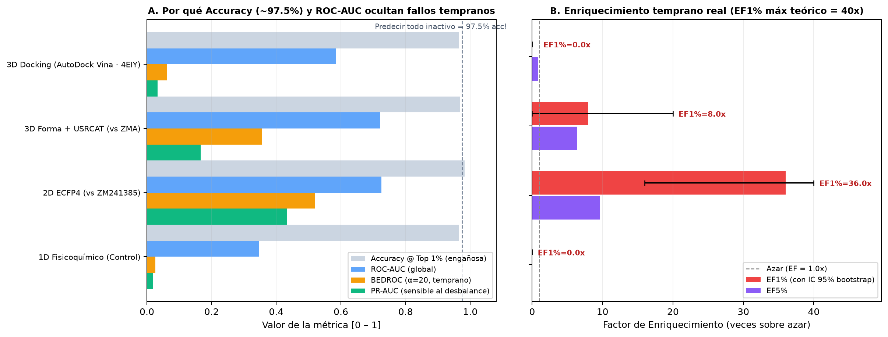

# ADORA2A Retrospective Virtual Screening & Curation Audit

Estudio de caso reproducible sobre el **receptor humano de adenosina $A_{2A}$** (`ADORA2A`, UniProt [`P29274`](https://www.uniprot.org/uniprotkb/P29274), ChEMBL [`CHEMBL251`](https://www.ebi.ac.uk/chembl/target_report_card/CHEMBL251/)) que demuestra cómo auditar estructuras GPCR, curar datos de bioactividad con procedencia completa, eliminar el sesgo fisicoquímico trivial de los *decoys* y evaluar de forma honesta métodos 1D, 2D, 3D de forma y docking molecular (**AutoDock Vina v1.2.7**).

---

## Por qué existe este proyecto

Las campañas de cribado virtual y los modelos de *Machine Learning* en descubrimiento de fármacos suelen fracasar en prospectivo por cuatro artefactos evitables aguas arriba:

1. **Selección ciega de estructuras (`ORDER BY resolution ASC`):** usar estructuras con estado conformacional incompatible (agonista vs. antagonista) o con mutaciones termoestabilizantes dentro del propio bolsillo ortostérico (`StaR2` `T88A`/`S277A`).
2. **Datos de bioactividad sin curación ni trazabilidad:** mezclar ensayos incompatibles ($K_i$ de equilibrio vs. $IC_{50}$ funcional), perder el `assay_chembl_id` o aplicar filtros PAINS/Brenk a ciegas descartando fármacos clínicos reales.
3. **Fuga fisicoquímica trivial en el benchmark:** evaluar frente a *decoys* no emparejados donde una regresión logística sobre `MW`, `cLogP` y `TPSA` ya alcanza $\text{ROC-AUC} > 0,80$ sin mirar la estructura 2D ni el bolsillo 3D.
4. **Métricas engañosas y confusión entre *score* y afinidad:** reportar *accuracy* (~97,5 %) o solo `ROC-AUC` global ignorando el enriquecimiento temprano (**EF1%**, **BEDROC**), o asumir correlación lineal entre el *score* de docking y el $pK_i$ experimental.

---

## Principales resultados y figuras

### 1. Auditoría de 188 estructuras PDB/GPCRdb (`reports/structure_audit.md`)

- **El 66,0 % (`124 / 188`)** de las estructuras humanas de $A_{2A}$ en el PDB utilizan el constructo termoestabilizado `StaR2`, incluidas las dos de mayor resolución nominal (`5NM4` a 1,70 Å y `5IU4` a 1,72 Å), que mutan **`Thr88Ala` ($3.36$)** y **`Ser277Ala` ($7.42$)** directamente dentro del bolsillo ortostérico.
- **0 de las 15 estructuras activas (`0 %`)** conservan el ion $\text{Na}^+$ alostérico en $\text{Asp52}^{2.50}$, frente al **84,3 % (`145 / 172`)** de las inactivas (**100 %** a $\le 1,90\text{ Å}$).
- **Decisión fundamentada:** se selecciona **`4EIY` (1,80 Å, 7TM 100 % *wild-type* + $\text{Na}^+$ alostérico + `ZM241385`)** como referencia para antagonistas y **`9EE8` (2,63 Å, cryo-EM acoplada a $G_s$ con adenosina)** como referencia activa.


---

### 2. Curación de `CHEMBL251` y puerta *Go / No-Go* de sesgo 1D

- De **12.105** registros `Ki`/`IC50` en ChEMBL se filtran medidas exactas (`confidence_score >= 8`, `standard_relation == '='`, unidades normalizadas a `nM`, sin avisos de invalidez) y se separa estrictamente la cohorte de equilibrio **`Ki_B` (`5.901` medidas $\rightarrow$ `4.972` compuestos padre únicos por `InChIKey`)**, excluyendo `546` agonistas del cribado inactivo y señalando `44` compuestos con discrepancia inter-ensayo $> 1$ unidad log.
- **Alertas estructurales con contexto:** un borrado ciego PAINS/Brenk eliminaría tres antagonistas clínicos co-cristalizados de Fase 2/3 (`Tozadenant`, `Vipadenant` e `Imaradenant`).
- **Control de fuga 1D superado (*GO*):** en *decoys* aleatorios de ChEMBL, un clasificador 1D (`MW`, `cLogP`, `TPSA`, `HBD`, `HBA`, `RotBonds`, `Charge`) obtiene **ROC-AUC = `0,81` (LogReg) / `0,78` (RF)** por la elevada `TPSA` de los heterociclos nitrogenados de $A_{2A}$. Con nuestro emparejamiento multivariante 7D + filtro topológico (`ECFP4 < 0,35`), el ROC-AUC cae a **`0,48` / `0,35`** ($< 0,60$).


---

### 3. Benchmark retrospectivo de 4 niveles (1.000 compuestos · 2,5 % hits)

| Método evaluado | EF1% (IC 95%) | EF5% | BEDROC ($\alpha=20$) | ROC-AUC | PR-AUC | Accuracy @ Top 1% |
| :--- | :---: | :---: | :---: | :---: | :---: | :---: |
| **1. Control negativo 1D (RF fisicoquímico)** | `0,0x` `(0,0–0,0)` | `0,0x` | `0,026` | `0,346` | `0,019` | `96,5 %` |
| **2. Similitud 2D ECFP4 (vs. `ZM241385`)** | **`36,0x`** `(16,0–40,0)` | **`9,6x`** | **`0,519`** | `0,725` | **`0,433`** | `98,3 %` |
| **3. Forma 3D (`ETKDGv3` + `USRCAT` + `O3A`)** | `8,0x` `(0,0–20,0)` | `6,4x` | `0,355` | `0,722` | `0,166` | `96,9 %` |
| **4. Docking 3D (`AutoDock Vina v1.2.7` · `4EIY`)** | **`0,0x`** `(0,0–0,0)` | `0,8x` | `0,063` | `0,584` | `0,033` | `96,5 %` |

- **Por qué `ROC-AUC` y `Accuracy` engañan:** `2D ECFP4` (`0,725`) y `3D Forma + USRCAT` (`0,722`) presentan un `ROC-AUC` idéntico, pero `2D ECFP4` recupera **4,5 veces más activos en el Top 1% (`EF1% = 36,0x` vs. `8,0x`)**. Mientras tanto, predecir "todo inactivo" daría **`97,5 %` de *accuracy***.
- **Resultado negativo transparente sobre docking rígido deshidratado:** una vez neutralizado el sesgo de peso molecular y `TPSA`, el docking rígido sobre `4EIY` sin aguas cristalográficas cae a `EF1% = 0,0x` (`ROC-AUC = 0,584`; `0,625` en el subconjunto sin análogos de `ZM241385`), debido a la degeneración energética al retirar las aguas puente `HOH 2503–2505` (`ΔE = 0,15 kcal/mol` en el re-docking cognado de `ZM241385`) y a la rigidez inducida del bolsillo.




---

### 4. Score de cribado $\neq$ afinidad experimental ($pK_i$)

Sobre un panel de **60 ligandos con $K_i$ experimental** que abarca más de 5 órdenes de magnitud ($pK_i \in [4,0;\; 11,0]$), ni la energía de AutoDock Vina ($r = +0,16$, $R^2 = 0,03$, $p = 0,22$) ni la similitud 2D ECFP4 ($r = +0,25$, $R^2 = 0,06$) correlacionan linealmente con la afinidad experimental.


---

## Estructura del repositorio

- [`src/adora2a_audit/`](src/adora2a_audit/)
  - [`structures.py`](src/adora2a_audit/structures.py) — auditoría combinada GPCRdb + RCSB PDB y verificación atómica de residuos del bolsillo con `gemmi`.
  - [`curation.py`](src/adora2a_audit/curation.py) — curación de `CHEMBL251` con procedencia completa, estandarización RDKit y auditoría contextual PAINS/Brenk.
  - [`decoys.py`](src/adora2a_audit/decoys.py) — generación de *decoys* emparejados en 7D y puerta *go/no-go* de sesgo fisicoquímico 1D.
  - [`metrics.py`](src/adora2a_audit/metrics.py) — implementación analítica consciente de empates de `EF1%`, `EF5%`, `BEDROC` ($\alpha=20$), `ROC-AUC`, `PR-AUC` e intervalos bootstrap.
  - [`benchmark.py`](src/adora2a_audit/benchmark.py) — preparación a pH 7,4 de `4EIY`, re-docking cognado, similitud 2D + *Murcko scaffold split*, forma 3D (`USRCAT` + `CrippenO3A`) y docking paralelo `--batch` con AutoDock Vina.
- [`scripts/run_audit_pipeline.py`](scripts/run_audit_pipeline.py) — pipeline CLI determinista de extremo a extremo.
- [`notebooks/01_adora2a_retrospective_audit.ipynb`](notebooks/01_adora2a_retrospective_audit.ipynb) — cuaderno interactivo ejecutado con tablas y figuras.
- [`reports/structure_audit.md`](reports/structure_audit.md) — auditoría detallada de las 188 estructuras de `ADORA2A`.
- [`reports/executive_summary.md`](reports/executive_summary.md) — informe ejecutivo y recomendaciones de arquitectura para equipos de IA/datos.
- [`tests/`](tests/) — suite de tests unitarios (`pytest`) para curación, métricas, estructuras y *decoys*.

---

## Reproducibilidad rápida

```bash
# 1. Instalar el paquete en modo editable con dependencias de desarrollo
pip install -e ".[dev]"

# 2. Ejecutar el pipeline completo (reutiliza cachés en data/cache/ y scores procesados)
python scripts/run_audit_pipeline.py

# 3. Verificar tests unitarios y estilo de código
pytest -v
ruff check .
```

## Fuentes de datos y licencias

- **GPCRdb:** datos estructurales y de estado conformacional obtenidos a través de la API REST de [GPCRdb](https://gpcrdb.org/).
- **RCSB PDB:** metadatos cristalográficos y coordenadas atómicas sujetos a la [RCSB PDB Usage Policy](https://www.rcsb.org/pages/usage-policy).
- **EMBL-EBI ChEMBL:** datos de bioactividad y estructuras químicas distribuidos bajo licencia [CC BY-SA 3.0](https://chembl.gitbook.io/chembl-interface-documentation/about).
