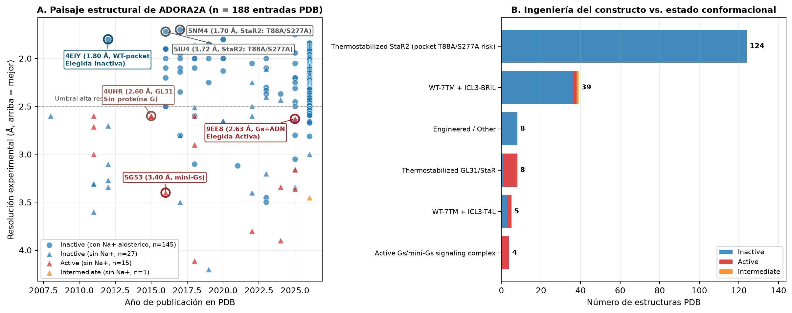

# Auditoría Estructural de ADORA2A (`P29274` · `aa2ar_human`)

## 1. Propósito de la auditoría

En cribado virtual basado en estructura (SBVS) y en modelos generativos/3D sobre GPCRs, **elegir el PDB de menor resolución nominal (`ORDER BY resolution ASC LIMIT 1`) es un error frecuente y costoso**:

1. **Incompatibilidad conformacional (agonista vs. antagonista):** la activación del receptor de adenosina $A_{2A}$ (`ADORA2A`) acoplado a proteína $G_s$ implica el desplazamiento intracelular de TM6 (~14 Å), la contracción del subbolsillo profundo de ribosa ($\text{Thr88}^{3.36}$, $\text{Ser277}^{7.42}$, $\text{His278}^{7.43}$) y el colapso del sitio alostérico de $\text{Na}^+$ en $\text{Asp52}^{2.50}$. Cribado de antagonistas sobre estructuras activas —o de agonistas ribosídicos sobre estructuras inactivas— introduce un sesgo geométrico sistemático.
2. **Artefactos de ingeniería cristalográfica (`StaR2` vs. fusiones intracelulares):** muchas estructuras de ultra-alta resolución de $A_{2A}$ utilizan el constructo termoestabilizado **`A2A-StaR2`** (8–9 mutaciones puntuales), que incluye **`T88A` ($3.36$)** y **`S277A` ($7.42$)** **dentro del propio bolsillo ortostérico**, eliminando dos grupos hidroxilo polares esenciales.
3. **Protonación y red de aguas estructurales:** en el bolsillo ortostérico, $\text{Glu169}^{\text{ECL2}}$ y $\text{Asn253}^{6.55}$ forman puentes de hidrógeno direccionales (2,79–3,17 Å) con el núcleo heteroaromático del ligando; una protonación ingenua sin ajuste a pH 7,4 convierte $\text{Glu169}$ en dador neutro (`-COOH`) y voltea la pose cristalográfica de `ZM241385` 180°.

---

## 2. Panorama global de las 188 estructuras experimentales

Combinando el catálogo actualizado de **GPCRdb** (`/services/structure/protein/aa2ar_human/`) con los metadatos de entidades poliméricas y mutaciones de **RCSB PDB** (`data/processed/adora2a_structures_audit.csv`), auditamos **188 estructuras experimentales** humanas:

| Estado conformacional (GPCRdb) | X-ray diffraction | Cryo-EM | Electron crystallography | Total | Con $\text{Na}^+$ alostérico resuelto ($\text{Asp52}^{2.50}$) |
| :--- | :---: | :---: | :---: | :---: | :---: |
| **Inactive** | 166 | 4 | 2 | **172** | **145 / 172 (84,3 %)** *(100 % a $\le 1,90\text{ Å}$)* |
| **Active** | 11 | 4 | 0 | **15** | **0 / 15 (0 %)** — bolsillo de $\text{Na}^+$ colapsado |
| **Intermediate** | 0 | 1 | 0 | **1** | **0 / 1 (0 %)** (`9XQB`, complejo con Fab `mAb16`) |
| **Total** | **177** | **9** | **2** | **188** | **145 / 188 (77,1 %)** |

> **Dos hallazgos cuantitativos clave en el catálogo completo (`n = 188`):**
> 1. **Riesgo masivo de mutación del bolsillo (`66,0 %`):** **124 de las 188 estructuras (`66,0 %`)** corresponden a constructos termoestabilizados `StaR2` con riesgo directo de mutaciones `T88A` y `S277A` dentro del bolsillo ortostérico, frente a solo **39 estructuras (`20,7 %`)** con dominio 7TM *wild-type* estabilizado por fusión intracelular `ICL3-BRIL`.
> 2. **Interruptor alostérico de $\text{Na}^+$:** **0 de las 15 estructuras activas (`0 %`)** conservan el ion $\text{Na}^+$ en $\text{Asp52}^{2.50}$, frente a **145 de las 172 estructuras inactivas (`84,3 %`, y `100 %` a $\le 1,90\text{ Å}$)**, reflejando la expulsión alostérica de $\text{Na}^+$ durante la activación del receptor.

---

## 3. Comparativa crítica de candidatos de alta resolución

### 3.1 Candidatos para cribado de **antagonistas / agonistas inversos** (estado `Inactive`)

| PDB | Resolución | Método | Ligando ortostérico | Fusión / Complejo | Mutaciones en cadena receptora | Verificación atómica del bolsillo (`structures.py`) | Decisión |
| :--- | :---: | :--- | :--- | :--- | :---: | :--- | :--- |
| **`5NM4`** | **1,70 Å** | XFEL | `ZM241385` (`ZMA`) | `BRIL` (ICL3) | **9 (`StaR2`)** | Numeración secuencial alterada + mutaciones **`T88A` y `S277A` dentro del bolsillo** | **Descartada** (bolsillo mutado) |
| **`5IU4`** | **1,72 Å** | X-ray | `ZM241385` (`ZMA`) | `BRIL` (ICL3) | **11 (`StaR2`)** | Confirmado en coordenadas: `88 = ALA` (`T88A`) y `277 = ALA` (`S277A`) | **Descartada** (bolsillo mutado) |
| **`9H37`** | **1,72 Å** | X-ray | `Compound 9` (`A1IR0`) | `BRIL` (ICL3) | 0 en 7TM | Quimiotipo específico reciente; menor comparabilidad histórica | Alternativa secundaria |
| **`4EIY`** | **1,80 Å** | X-ray | **`ZM241385` (`ZMA`)** | `BRIL` (ICL3, res. 1001–1106) | **0 en 7TM** *(3 solo dentro de BRIL)* | **100 % Wild-Type** (`D52`, `T88`, `F168`, `E169`, `W246`, `H250`, `N253`, `S277`, `H278`) + $\text{Na}^+$ resuelto | **ELEGIDA (Referencia Inactiva)** |
| **`7IO5`** | **1,84 Å** | X-ray | `Theophylline` + fragmento `FU12-45` | `BRIL` (`StaR2`) | **8 (`StaR2`)** | Co-cristalización con fragmentos alostéricos/secundarios + `StaR2` | **Descartada** |
| **`3EML`** | **2,60 Å** | X-ray | `ZM241385` (`ZMA`) | `T4L` (ICL3) | 0 en 7TM | Resolución inferior (2,60 Å); no resuelve el ion $\text{Na}^+$ ni la red completa de aguas | **Descartada** (superada por `4EIY`) |

### 3.2 Candidatos para estudios de **agonistas** (estado `Active`)

| PDB | Resolución | Método | Ligando ortostérico | Proteína señalizadora / Fusión | Mutaciones | Verificación estructural | Decisión |
| :--- | :---: | :--- | :--- | :--- | :---: | :--- | :--- |
| **`9EE8`** | **2,63 Å** | Cryo-EM | **`Adenosine` (`ADN`)** | **Heterotrímero $G_s$ completo + `Nb35`** (sin fusión ICL3) | 2 (fuera del bolsillo) | **100 % Wild-Type** en bolsillo ortostérico; estado activo fisiológico acoplado a $G_s$ a alta resolución | **ELEGIDA (Referencia Activa)** |
| **`5G53`** | **3,40 Å** | X-ray | `NECA` (`NEC`) | `mini-Gs` | 1 (`N154Q` deglicosilación) | Bolsillo WT acoplado a `mini-Gs`, pero menor resolución (3,40 Å) frente a `9EE8` | Referencia cristalográfica histórica |
| **`4UHR`** | **2,60 Å** | X-ray | `CGS 21680` (`NGI`) | Ninguna (`GL31` termoestabilizado) | **5 (`GL31`)** | Carece de proteína G acoplada (*active-like intermediate* intracelular) y porta 5 mutaciones termoestabilizantes | **Descartada como activa primaria** |
| **`5WF5`** | **2,60 Å** | X-ray | `UK-432,097` (`UKA`) | `T4L` (ICL3), sin proteína G | 5 | Estabilizada únicamente por agonista voluminoso + fusión `T4L`, sin acoplamiento a $G_s$ | **Descartada** |

---

## 4. Decisión explícita y geometría del bolsillo para la Fase 3

1. **Referencia Inactiva seleccionada (`4EIY`, 1,80 Å):**
   - Sacrificar únicamente **0,08–0,10 Å** de resolución nominal respecto a `5NM4`/`5IU4` evita introducir dos mutaciones artificiales de alanina (`T88A`, `S277A`) en la pared polar profunda del bolsillo.
   - La proteína de fusión citocromo $b_{562}\text{RIL}$ (`BRIL`, residuos `1001–1106`) está insertada en el bucle intracelular `ICL3` a **> 28 Å** del centroide ortostérico, por lo que puede escindirse limpiamente sin perturbar las hélices transmembrana ni los bucles extracelulares (`ECL2`/`ECL3`, con sus cuatro puentes disulfuro intactos).
   - **Geometría verificada de reconocimiento de `ZM241385` en `4EIY`:**
     - `Glu169.OE2` $\cdots$ `ZMA.N15` (amina exocíclica): **2,79 Å**
     - `Asn253.OD1` $\cdots$ `ZMA.N15` (amina exocíclica): **2,79 Å**
     - `Asn253.ND2` $\cdots$ `ZMA.O25` (oxígeno furánico): **3,01 Å** y `ZMA.N17`: **3,17 Å**
     - Apilamiento aromático $\pi$-$\pi$ con `Phe168` (`ECL2`).
   - **Caja de docking ortostérica (definida estrictamente desde el ligando cristalográfico `ZMA`):** centroide `(-0.424, 8.527, 17.127)` Å, dimensiones `20.0 × 20.0 × 20.0` Å.

2. **Referencia Activa seleccionada (`9EE8`, 2,63 Å):**
   - Representa el estado activo canónico acoplado al heterotrímero $G_s$ con el agonista endógeno **adenosina (`ADN`)** y bolsillo 100 % *wild-type*, documentando por qué los agonistas ribosídicos **deben excluirse** del benchmark retrospectivo sobre la estructura inactiva `4EIY`.
